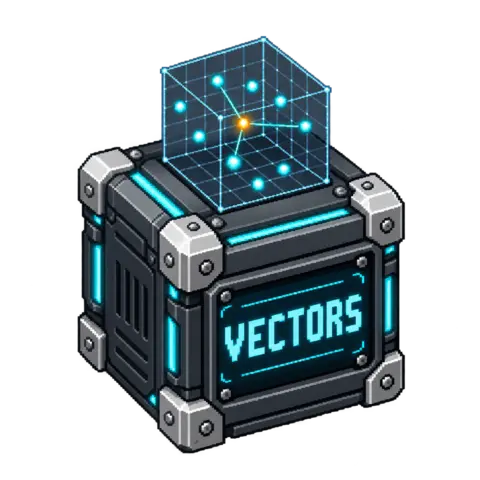

# Vector Store

Embed texts and search them by meaning in a local vector collection. The block sends
texts to an OpenAI-compatible `/embeddings` endpoint you configure (a local Ollama,
LM Studio or vLLM server, or a hosted API), keeps the vectors in a SQLite file in the
node's own storage, and answers a question with the most similar stored passages. It is
the retrieval half of a RAG graph: it returns passages and scores, never a generated
answer.

<!-- block-metadata:start -->
[](model.json)
[](compatibility.json)
[](LICENSE)

Verified BloxSmith versions: **1.0.9** (bundled-block tests; see [test evidence](compatibility.json)).
<!-- block-metadata:end -->

[](media/cover.png)

Use it to index manuals, tickets, notes or extracted document text, then feed the best
passages to a chat block as context, find similar records, or deduplicate by meaning.

## Ports

| Direction | Port | Meaning |
| --- | --- | --- |
| Input | `documents` | Texts to index, or a `delete` / `stats` operation (see [Messages](#messages)) |
| Input | `query` | A question as plain text, or a query object with options, or `stats` |
| Output | `matches` | Ranked passages for a query (see [Results](#results)) |
| Output | `result` | Summary of a successful upsert, delete or stats operation |
| Output | `error` | Machine-readable failure; nothing else is published for that message |

Both inputs are optional: connect the one(s) you use. Each message is handled on its own
in One Shot and Active Runtime. When one activation carries a `documents` message and a
`query` message, the `documents` message is applied first. Two messages on the same input
in a single activation are refused with the `batch` error code; nothing from that input is
processed. A failed message is a normal activation that publishes `error`; invalid
settings fail the Run before anything is sent.

## Messages

### `documents`

| Message | Effect |
| --- | --- |
| Plain text | Index one text |
| `{"id": "...", "text": "...", "metadata": {...}}` | Index one document; `id` and `metadata` are optional |
| `[ "text", {"id": ..., "text": ...}, ... ]` | Index up to 1,000 documents in one message |
| `{"documents": [ ... ]}` or `{"operation": "upsert", "documents": [ ... ]}` | Same as an array |
| `{"operation": "delete", "ids": ["..."]}` | Delete documents (all their chunks) or single chunks by id |
| `{"operation": "delete", "filter": {"key": value}}` | Delete every item whose metadata matches |
| `{"operation": "delete", "all": true}` | Empty the collection and release its model binding |
| `{"operation": "stats"}` | Report counts without calling the endpoint |

A message starting with `{` or `[` must be valid JSON; anything else is indexed as plain
text. Document objects accept `id`, `text` and `metadata` only: put titles, URLs or page
numbers in `metadata`. Deletion is refused unless `allow_delete` is checked.

**Identifiers are deterministic.** A document without `id` gets `sha256:` followed by the
first 32 hexadecimal characters of the SHA-256 of its text, so indexing the same text twice
updates one item. Ids are 1–200 visible characters without spaces or `#`. When a text is
split, its chunks get the ids `<id>#0`, `<id>#1`…; a text that fits in one chunk keeps the
plain id. Re-indexing a document replaces all its chunks and removes chunks that no longer
exist. A chunk whose embedded text did not change is **not sent to the endpoint again**:
its stored vector is reused and only its metadata is updated.

### `query`

Plain text is the question. An object adds options:

```json
{"text": "How do I reset the pump?", "top_k": 3, "min_score": 0.3, "filter": {"product": "P-200", "lang": "en"}}
```

`top_k` (1–100) and `min_score` (−1 to 1) override the settings for this query. `filter`
keeps items whose metadata has **exactly** these top-level values (strings, numbers,
booleans or `null`; at most 16 keys, all must match). `1` and `1.0` are equal; `true` and
`1` are not; nested metadata values are stored but not filterable.

## Results

`matches` for a query:

```json
{
  "collection": "default", "model": "nomic-embed-text", "dimension": 768,
  "query": "How do I reset the pump?", "top_k": 3, "min_score": 0.3, "filter": {},
  "searched": 412, "count": 2, "similarity": "numpy",
  "items": [
    {"id": "manual-p200#4", "score": 0.712843, "text": "To reset the pump…", "metadata": {"product": "P-200"},
     "source_id": "manual-p200", "chunk": {"index": 4, "count": 9, "start": 3610, "end": 4588}}
  ],
  "context": "To reset the pump…\n\n---\n\n…"
}
```

`score` is the cosine similarity rounded to 6 decimals; items are sorted by score, then id.
`chunk.start`/`end` are character offsets in the original text. `context` joins the
returned texts, ready to paste into a prompt. `searched` is the number of candidates after
filtering; when it is 0 the endpoint is not called and `items` is empty.

`result` for an upsert reports `documents`, `chunks`, `embedded` (sent to the endpoint),
`unchanged` (vectors reused), `removed_stale`, `items` (total in the collection), the
collection `revision`, the indexed `sources` (first 1,000) and the bound `model` and
`dimension`. A delete reports `deleted`, `items`, `selector` and `reset`. Stats report
`items`, `sources`, `model`, `dimension`, `configured_model`, `revision`, `database_bytes`
and `similarity` (`numpy` or `python`).

`error` carries `code`, `message`, `retryable`, `operation` and `input`, plus
`http_status` and a short sanitized `provider_message` for endpoint errors, and
`additional_errors` when two messages of the activation failed. Codes:

| Code | Meaning |
| --- | --- |
| `input`, `batch` | Malformed message, or several messages on one input in one activation |
| `model_mismatch`, `dimension_mismatch` | The collection was built with another model or vector size |
| `capacity` | `max_items`, `max_database_mb` or the 16-collections-per-node limit would be exceeded |
| `delete_disabled` | A delete arrived while `allow_delete` is off |
| `secret` | The wallet is locked or `api_key_ref` cannot be resolved |
| `auth`, `rate_limited`, `provider_rejected`, `provider_unavailable`, `http_status` | HTTP 401/403, 408/429, 400/404/413/422, 5xx, other |
| `provider_response` | Malformed, oversized, compressed, base64 or zero-vector response |
| `network`, `timeout`, `cancelled` | Connection, DNS, TLS or address policy; deadline; Stop |
| `dependency` | A search too large for the pure-Python scan and numpy is missing |
| `storage`, `concurrent_change`, `internal` | Storage unavailable or unsafe; collection changed during embedding (retry); unexpected failure |

Writes are atomic per message: on any error nothing from that message is stored. No
request is retried automatically.

## Settings

| Setting | Default | Meaning |
| --- | --- | --- |
| `collection` | `default` | Collection name (1–64 letters, digits, `.`, `_`, `-`) |
| `base_url` | `http://127.0.0.1:11434/v1` | OpenAI-compatible API root; the block calls `<base_url>/embeddings` |
| `model` | `nomic-embed-text` | Embedding model name sent to the endpoint |
| `api_key_ref` | empty | Optional wallet reference `secret://workspace/<name>`, sent as `Authorization: Bearer` |
| `top_k` | 5 | Matches per query, 1–100 |
| `min_score` | 0 | Minimum cosine similarity, −1 to 1 |
| `chunk_size` | 1000 | Chunk length in characters (0 = no chunking, else 100–100,000, at most `max_text_chars`) |
| `chunk_overlap` | 100 | Characters shared by consecutive chunks, at most half of `chunk_size` |
| `allow_delete` | off | Accept delete operations |
| `query_prefix`, `document_prefix` | empty | Text prepended before embedding queries / chunks (≤ 200 characters) |
| `allow_remote` | off | Allow a non-loopback endpoint host |
| `allow_insecure_http` | off | Allow plain HTTP to a non-loopback host (never with an API key) |
| `ca_file` | empty | Absolute path of a PEM CA file for an HTTPS endpoint with a private CA |
| `batch_size` | 32 | Texts per embeddings request, 1–512 |
| `timeout_sec` | 60 | Time allowed for one message, requests included, 1–600 |
| `max_items` | 20,000 | Maximum stored chunks, 1–200,000 |
| `max_text_chars` | 8,000 | Maximum characters per chunk or query, 100–100,000 |
| `max_input_bytes` | 4 MiB | Maximum input message size |
| `max_response_bytes` | 16 MiB | Maximum embeddings response size |
| `max_database_mb` | 512 | Maximum collection file size in MiB, 16–8,192 |

Chunking cuts at whitespace when one is found in the last quarter of the window, trims
surrounding whitespace and starts an overlapping chunk on a word boundary. Characters are
Python characters, not model tokens: keep `chunk_size` below your model's context.

## Embeddings endpoint

The request is `POST <base_url>/embeddings` with `{"model": ..., "input": [...]}`; the
response must contain one float array per input in `data[].embedding`. Examples:

| Server | `base_url` | Notes |
| --- | --- | --- |
| Ollama | `http://127.0.0.1:11434/v1` | `ollama pull nomic-embed-text`; for this model set `document_prefix` to `search_document: ` and `query_prefix` to `search_query: ` |
| LM Studio | `http://127.0.0.1:1234/v1` | Load an embedding model first |
| vLLM | `http://127.0.0.1:8000/v1` | Start vLLM with an embedding model |
| Hosted API | `https://api.openai.com/v1` | Check `allow_remote`; store the key in the wallet and set `api_key_ref` |

Loopback endpoints (`localhost`, `127.0.0.1`, `::1`) work without extra settings. Any other
host requires `allow_remote`; plain HTTP to it also requires `allow_insecure_http`, and an
API key is then refused. Host names are resolved once per request, every resolved address
is checked, and the connection goes to the checked address: link-local (including cloud
metadata `169.254.169.254`), multicast and unspecified addresses are always refused. HTTPS
verifies the certificate and host name; there is no option to disable verification.

## Collections and storage

A collection is a SQLite file in this node's persistent storage
(`…/instances/<instance>/blocs/<node>/vectors-<hash>.sqlite3`, mode 0600). It survives new
Runs, Stop and reopening, and is shared by the two inputs of **this node only**: index and
query through the same node. Another node, instance or blueprint has its own collections.
A node holds at most 16 collections.

The first stored vectors **bind the collection to the model name and vector dimension**.
Later upserts and queries with another `model` are refused (`model_mismatch`), and vectors
of another size are refused (`dimension_mismatch`). To change model, send
`{"operation": "delete", "all": true}` (with `allow_delete`) or use a new `collection`
name. Changing the endpoint while keeping the same model name is not detected. Changing a
prefix re-embeds a document the next time it is indexed but does not convert vectors
already stored.

Vectors are stored L2-normalized as little-endian float32. A query compares the question
with every candidate (exact search, no approximate index). numpy is used when installed;
otherwise a pure-Python scan handles up to 8,000,000 values per query (for example 10,000
items of 768 dimensions) and larger searches fail with `dependency`.

## Example

1. A Document Reader (or a Text node) sends `[{"id": "manual-p200", "text": "...", "metadata": {"product": "P-200"}}]`
   to `documents`. `result` reports the chunks embedded.
2. A chat question goes to `query`. `matches.context` feeds the prompt of a chat block,
   and `matches.items[].source_id`/`chunk` let the answer cite its sources.

## Vector Store or Document Search?

[Document Search](https://github.com/HackInvent/bloxmith-document-search) finds passages
containing the **words** of the question in a local full-text index, needs no model and is
exact about terms. Vector Store finds passages close in **meaning**, including paraphrases
and other languages when the model supports them, but needs an embeddings endpoint and its
scores depend on the model. Many graphs use both.

## Limits and warnings

- Similarity is not truth: a high score means "close for this model", not "correct".
  Indexed text is returned as data; treat it as untrusted when you pass it to a model.
- Exact search reads every candidate: large collections answer more slowly. Filters reduce
  the candidates.
- Texts and metadata are stored in clear in the node's storage and included in project
  ZIP exports. Do not index secrets.
- Hosted endpoints receive the texts you index and the questions you ask, and may bill
  for them.
- In managed or linked installations the framework terminates the block's host process on
  Stop; an upsert interrupted before its final write stores nothing.

## Dependencies

- Python standard library only (`http.client`, `ssl`, `sqlite3`); no SQLite extension is loaded.
- Optional: `numpy` (listed in [requirements.txt](requirements.txt)) for fast search of
  large collections, for example `pip install "numpy>=1.22"` in the Studio Python
  environment. The block imports it only when a search runs and works without it.

## Security notes

- The API key is read from the wallet at run time, only when a request is needed, and is
  sent only over HTTPS or to a loopback host. It is never written to settings, outputs,
  logs or errors; a provider error message that echoes it is redacted. `api_key_ref`
  refuses anything that is not a `secret://workspace/<name>` reference.
- Remote endpoints are off by default (`allow_remote`). The block opens no inbound port.
- Provider response bodies never reach outputs, except a short single-line
  `provider_message` taken from an HTTP error response.
- The node card and the compact (mobile) card show the collection and model only, never the
  endpoint or the reference.

## Tests and qualification

- `tests/F5.01_vector_store.py`: settings and endpoint policy, chunking, message parsing,
  deterministic ids, real SQLite storage with an explicit in-process embedding double:
  vector reuse, stale-chunk removal, exact cosine ranking checked against an independent
  computation, filters, `top_k`/`min_score`, numpy and pure-Python scans (and the
  `dependency` refusal), model/dimension binding, capacity rollback, deletion, Stop,
  deadlines, unsafe files, wallet handling, `execute_runtime` routing and Apply validation.
- `tests/F5.02_vector_store_runtime.py`: the real HTTP client against
  `tests/embeddings_fixture.py`, a loopback OpenAI-compatible server returning
  deterministic hashed bag-of-words vectors: Bearer key, batching and index order,
  401/429/404/503 mapping, redaction of an echoed key, malformed/base64/NaN/compressed/
  oversized responses, Stop and deadline during a pending request, HTTPS with a private CA
  and host-name verification, and DNS-answer vetting. Then real graph Runs in One Shot and
  Active Runtime for bundled, managed and linked installations: upsert and query across
  Runs in instance storage, filters, stats, deletion refusal and deletion, model mismatch,
  locked wallet, and Stop during a pending request.
- `tests/F8.01_vector_store_ui.py`: managed and linked browser hosts, Cancel/Apply, a
  pasted key refused by Apply, persistence, English and French, desktop and mobile widths
  for the modal and the inspector, and the block's compact card in the reduced display.

**Not qualified against a real embeddings provider.** Ollama, LM Studio, vLLM and hosted
APIs were not contacted: the protocol is tested with the loopback fixture above, whose
vectors are synthetic. Retrieval quality, real model dimensions, provider-specific
parameters and error bodies, rate limits and billing are not certified. No real credential
was used.

## Framing decisions

These choices complete the block framing where it left options open:

1. **Operations on ports**: upserts, `delete` and `stats` arrive on `documents`; queries
   (and `stats`) on `query`. `matches` carries query replies only and `result` the other
   operations, so a `documents` and a `query` message can complete in the same activation.
2. **Deterministic ids**: `sha256:` + 32 hexadecimal characters of the text; chunk ids add
   `#<index>`; `#` is reserved in document ids. Unchanged chunks reuse their vectors.
3. **Chunking on by default** (1,000 characters, overlap 100), cut at whitespace; 0 disables it.
4. **Model binding**: model name and dimension are stored with the collection; a mismatch is
   refused, and `delete` with `all: true` is the explicit way to rebind.
5. **Metadata filter**: exact equality on top-level scalar values, all keys required; filters
   also select items to delete.
6. **Endpoint policy**: loopback by default; `allow_remote`, `allow_insecure_http` and
   `ca_file` are explicit opt-ins; no automatic retry.
7. **numpy optional**: exact scan with numpy, pure-Python fallback bounded to 8,000,000
   values per query, then an explicit `dependency` error.
8. **Model prefixes** (`query_prefix`, `document_prefix`) are settings because several
   embedding models need task prefixes for good results.
9. **Defaults** target a local Ollama server with `nomic-embed-text`; change `base_url` and
   `model` for other servers.

## License

Apache-2.0. See [LICENSE](LICENSE).
